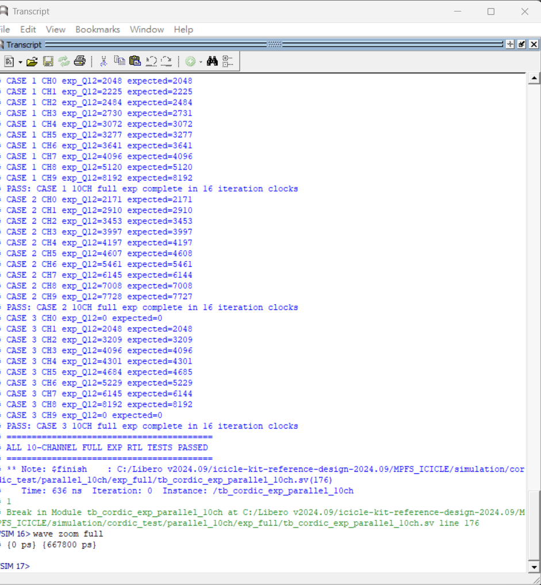
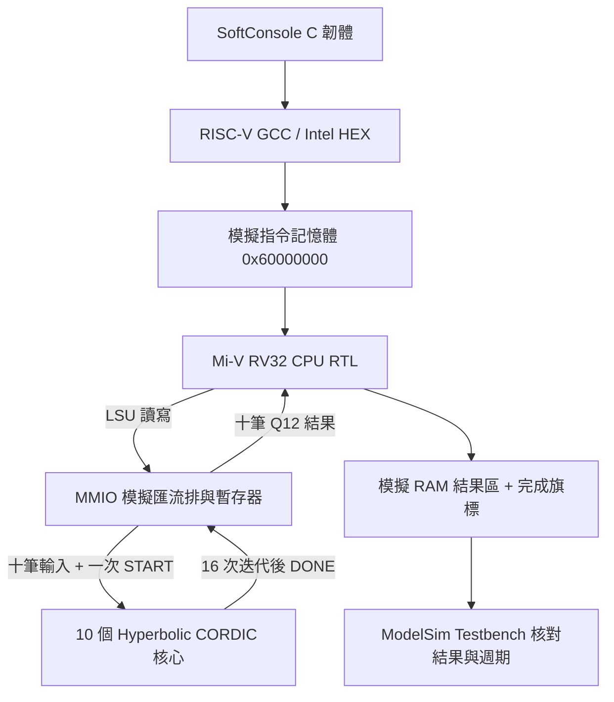
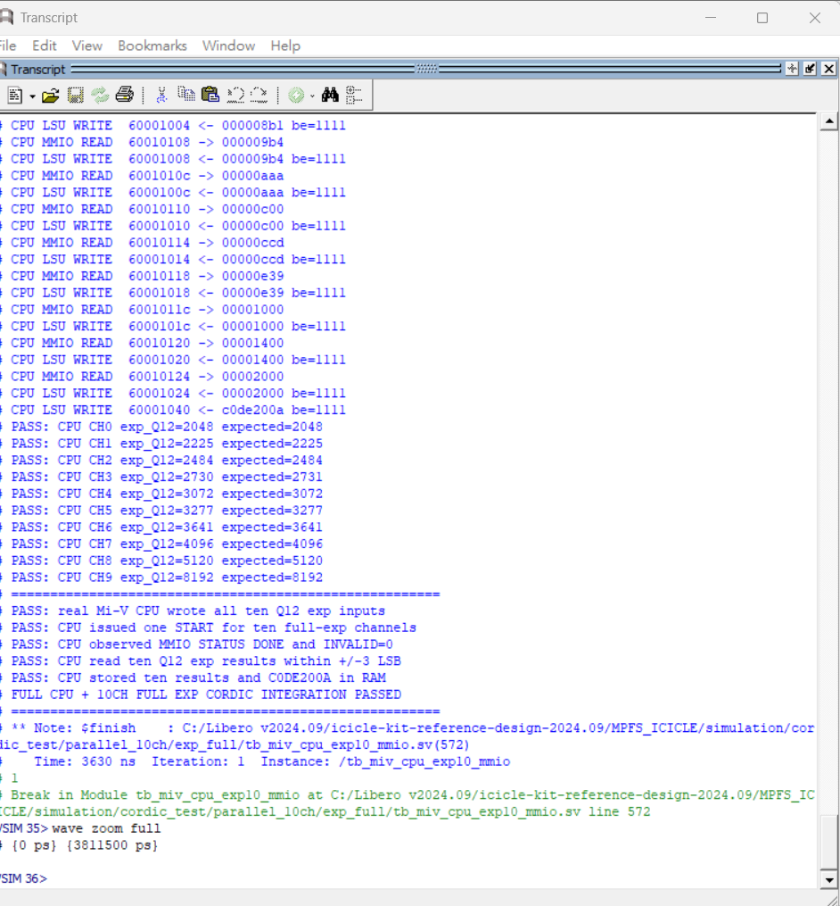
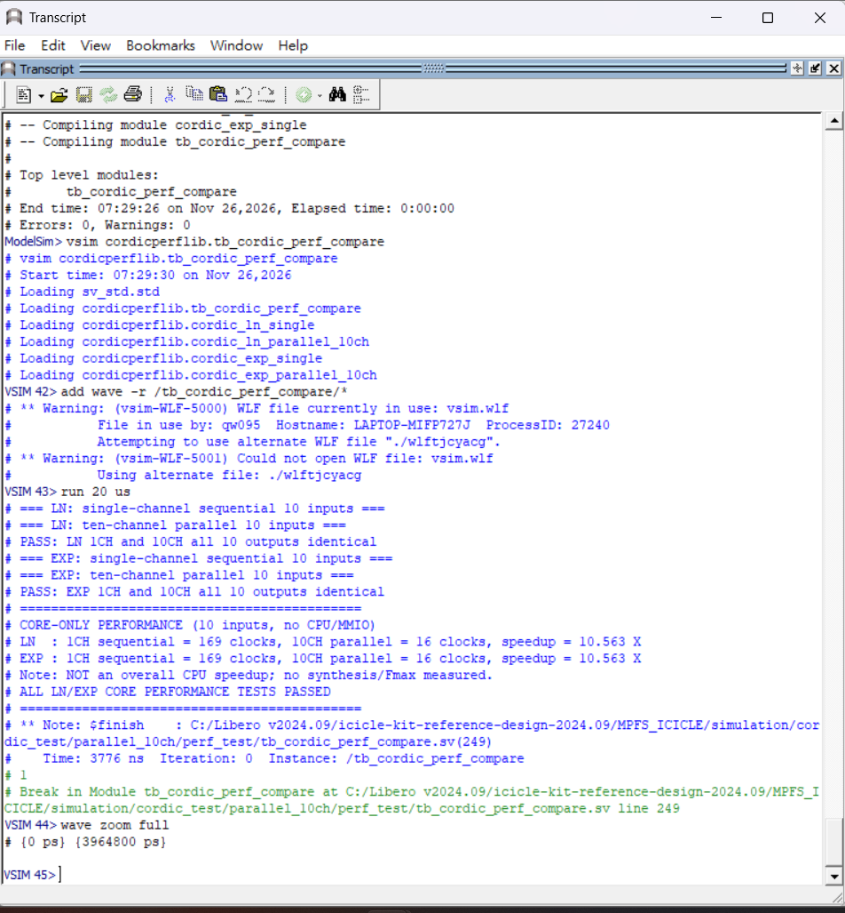

# Mi-V RV32 × 10 通道平行 Hyperbolic CORDIC｜ln／exp 軟硬體整合與效能比較

> 專題階段成果｜**SoftConsole + Mi-V RV32 + 自訂 MMIO 介面 + CORDIC RTL + ModelSim**  
> 狀態：**已完成 RTL 功能整合與模擬效能比較**；尚未完成 FPGA 實機驗證與綜合後資源／Fmax 分析。



## 30 秒摘要

本專題利用 **Hyperbolic CORDIC** 演算法，在 RTL 中實作自然對數 `ln(x)` 與指數函數 `exp(x)`，由 **SoftConsole** 編譯 RISC-V C 韌體，交由 **Mi-V RV32 CPU** 透過 **Memory-Mapped I/O（MMIO）** 寫入十筆輸入、發出一次 `START`、查詢 `DONE`，再讀回十筆結果寫入 RAM。ModelSim 的 CPU RTL Testbench 已驗證完整路徑。

為驗證平行化的效益，額外建立**只有一個實際 CORDIC 運算核心、依序處理十筆資料**的對照組，並沿用相同 CPU 韌體、十筆輸入與 MMIO 地址配置。

| 統計範圍（每次處理十筆） | ln：1CH → 10CH | exp：1CH → 10CH | 量測加速比 |
|:--|--:|--:|--:|
| **純 RTL 核心測試** | 169 → 16 cycles | 169 → 16 cycles | **兩者均 10.563×** |
| **CPU + MMIO 完整系統** | 522 → 352 cycles | 524 → 354 cycles | **ln 1.483×；exp 1.480×** |

**重要：** 核心與系統採不同量測範圍；不能把 10.563× 宣稱為 CPU 系統加速比。這些都是固定 **10 ns 模擬時脈**的 RTL 週期測試，不是 FPGA 實機 Fmax。

## 研究動機與工作目標

- 利用移位、加減與查表運算，實作雙曲 CORDIC 的 `ln`／`exp`。
- 將單通道運算器擴充為十個獨立通道，使十筆資料可同時迭代。
- 實現 CPU 可控的 MMIO：輸入暫存器、`START`、`STATUS`、`INVALID`、結果暫存器。
- 讓**真正的 Mi-V CPU RTL** 執行 SoftConsole 編譯出的機器碼，而不是 Testbench 直接假裝 CPU 計算。
- 比較單核心依序與十核心平行的正確性、硬體核心週期及 CPU 端到端週期。

## 系統架構



實驗對照組將圖中的 **10 個核心** 換成**1 個核心 + 依序排程控制器**，但保留相同的 CPU 韌體與 MMIO 操作方式。因此它測量的是**硬體並行化對相同 CPU 控制流程的影響**，不是「軟體逐筆發送十次 START」的不同 API 方案。

### 執行方式與早期自訂指令的差異

專題早期曾驗證 Mi-V EXU 的自訂指令 `CORDIC_END`，用於單步移位加減。**本 Repository 的十通道完整 ln／exp CPU 整合主軸則是 MMIO（CPU 執行一般 `lw/sw`）**，不是宣稱以十通道自訂指令直接完成 ln／exp。兩者是不同階段的驗證方法。

## CORDIC 核心與定點數設計

### ln：vectoring mode

\[
\ln(a)=2\,\operatorname{atanh}\left(\frac{a-1}{a+1}\right)
\]

輸入 `a` 採**無符號 Q12**（整數 4096 表示 1.0），第一版驗證區間為 `2048..8192`（0.5～2.0）；輸出是 **signed Q12**。硬體採十個獨立的 X／Y／Z 狀態，並行進行迭代。

### exp：rotation mode

\[
\exp(x)=\cosh(x)+\sinh(x)
\]

輸入為 **signed Q12**（約 `−ln(2)` 到 `+ln(2)`，以整數 `−2839..2839` 表示），輸出為**正值 Q12**。內部 X／Y／Z 與 `atanh` 查表使用較高精度；結果轉回 Q12。exp 採雙曲 CORDIC 增益補償常數，詳見 [`rtl/exp/cordic_exp_parallel_10ch.sv`](rtl/exp/cordic_exp_parallel_10ch.sv)。

### 16 次迭代

兩種運算的 shift 排列相同：

```text
1, 2, 3, 4, 4, 5, 6, 7, 8, 9, 10, 11, 12, 13, 13, 14
```

其中 `4`、`13` 重複是雙曲 CORDIC 所需的校正迭代。每次批次處理十筆時，十通道運算器在此測試中需 **16 個 BUSY 時脈週期**。

數值驗證容許 `±3` 個 Q12 LSB（約 `±0.0007324`），目前已完成固定測試向量及非法輸入檢查，尚**不是全範圍數學函式函式庫**。

## MMIO 與 RAM 位址

| 位址／區間 | 操作 | 內容 |
|---|---|---|
| `0x60010000`～`0x60010024` | CPU 寫入 | 十筆 Q12 輸入（每筆 4 bytes） |
| `0x60010080` | CPU 寫入 `1` | 全批次 `START` |
| `0x60010084` | CPU 讀取 | STATUS：bit0 = DONE、bit1 = BUSY |
| `0x60010088` | CPU 讀取 | INVALID：bit0～9 對應通道 |
| `0x60010100`～`0x60010124` | CPU 讀取 | 十筆 Q12 結果（每筆 4 bytes） |
| `0x60001000`～`0x60001024` | CPU 寫入 RAM | 十筆結果保存區 |
| `0x60001040` | CPU 寫入 RAM | 成功或失敗旗標 |

成功旗標：**ln = `0xC0DE100A`**；**exp = `0xC0DE200A`**。ln／exp 各自使用獨立模擬周邊與韌體，**並非兩個函數同時掛在相同 MMIO 位址**。

exp 的負數輸入必須使用 32-bit 符號延伸（例如 −2839 → `0xFFFFF4E9`）。此處的介面是**Testbench 專用的 CPU-like MMIO bus**，尚未經 SmartDesign 封裝成可在板上運行的正式 AXI/APB 外設。

## 功能驗證紀錄

| 測試層級 | 實際完成的驗證 | 結果 |
|---|---|:---:|
| 10CH ln RTL | 三批 ln、16 次迭代、非法輸入 | PASS |
| 10CH exp RTL | 三批 exp、16 次迭代、非法輸入 | PASS |
| 10CH ln／exp MMIO | START、STATUS、讀回、錯誤位址、符號延伸（exp） | PASS |
| CPU + 10CH ln | 真實 CPU 取指、MMIO、結果寫 RAM `C0DE100A` | PASS |
| CPU + 10CH exp | 真實 CPU 取指、MMIO、結果寫 RAM `C0DE200A` | PASS |
| 1CH vs 10CH 核心 | 十筆輸出逐筆一致、169 vs 16 cycles | PASS |
| CPU + 1CH serial | 真實 CPU、相同韌體、單運算核心依序處理十筆 | PASS |




## 性能測試與結果

| 函數 | 測試範圍 | 1CH serial | 10CH parallel | 速度提升 | 週期減少 |
|---|---|---:|---:|---:|---:|
| ln | 核心獨立測試 | 169 | 16 | **10.563×** | 153 |
| exp | 核心獨立測試 | 169 | 16 | **10.563×** | 153 |
| ln | CPU 端到端 | 522 | 352 | **1.483×** | 170 |
| exp | CPU 端到端 | 524 | 354 | **1.480×** | 170 |

**CPU 端到端定義：** 第一筆被接受的 CPU IFETCH → CPU 將成功旗標寫回模擬 RAM。包含 CPU 啟動程式、設定十筆輸入、START、等待 DONE、讀取十筆結果、軟體檢查與寫回 RAM；不包含 reset 放開到第一筆取指前的等待時間。

| CPU 階段（cycles） | ln 1CH | ln 10CH | exp 1CH | exp 10CH |
|---|---:|---:|---:|---:|
| `CPU_TOTAL_CYCLES` | **522** | **352** | **524** | **354** |
| `CPU_MMIO_TO_RAM_CYCLES` | 484 | 314 | 486 | 316 |
| `START_TO_CORE_DONE` | 192 | 18 | 192 | 18 |
| `CORE_BUSY_TO_DONE` | 190 | 16 | 190 | 16 |
| `CORE_DONE_TO_RAM_MARKER` | 254 | 258 | 254 | 258 |

計算：`Speedup = cycles(1CH) / cycles(10CH)`。例如 ln：`522/352 = 1.48295×`。同樣處理十筆資料時，ln 的 CPU 系統週期降低約 **32.6%**，exp 降低約 **32.4%**。

**為何核心可達 10.563×，整體只有約 1.48×？** CORDIC 核心可平行化，但 CPU 的記憶體讀寫、輪詢、十筆結果檢查及 RAM 寫回仍主要逐項進行。這是目前實驗的重要觀察。1CH 的 190 cycles 還包含十筆依序排程成本，不可視為單次運算的核心週期。



詳細原始數字：[performance.csv](results/performance.csv)／[system_detail.csv](results/system_detail.csv)；所有成功截圖請見 [`assets/screenshots`](assets/screenshots)。

## 專案檔案結構

```text
MiV_RV32_10CH_CORDIC_GitHub_Final/
├── README.md
├── rtl/
│   ├── ln/               # 10CH ln 核心與 MMIO
│   ├── exp/              # 10CH exp 核心與 MMIO
│   └── single_serial/    # 真正 1CH 核心與十筆依序排程 MMIO
├── sim/
│   ├── core/             # 核心功能與核心效能 Testbench
│   ├── mmio/             # MMIO 功能 Testbench
│   ├── cpu/              # 原版 10CH CPU 整合 Testbench
│   └── perf_cpu/         # 1CH/10CH CPU 效能 Testbench
├── firmware/
│   ├── mi-vuse_ln10.hex
│   ├── mi-vuse_exp10.hex
│   ├── *_words.mem
│   └── *_reference.c     # 流程參考 C 程式，非逐位元可重製原始碼
├── assets/screenshots/  # 成功的 ModelSim Transcript 原圖
├── results/             # CSV 週期統計
└── docs/
    ├── 教授報告講稿_約7分鐘.md
    ├── 核心程式碼說明.md
    ├── ModelSim重現操作.md
    └── GitHub上傳教學.md
```

## 快速重現

詳見 [ModelSim 重現操作](docs/ModelSim重現操作.md)，提供 10CH core、MMIO 與完整 CPU 的分階段指令。**CPU 測試需要您本機已編譯的 Mi-V RV32 hart 原始碼與 Microchip 相關 package；本 Repository 不包含其原廠 IP。** 模擬依據來自你們的 SoftConsole 2022.2 與 ModelSim Microsemi Pro 2022.2／Libero 2024.09 專題環境。

## 已知限制與未來工作

- 目前是**RTL 模擬驗證**；尚未進行 FPGA bitstream 下載、板上驗證、Libero 綜合資源統計與 Fmax。
- ln 的第一版輸入域為 0.5～2.0；exp 為約 −ln2～+ln2，未做廣泛的 range reduction／overflow 驗證。
- 系統效能以相同韌體與一筆批次 START 作公平對照，尚未涵蓋 DMA、快取、多批串流或真實匯流排時序。
- Firmware 的 `.hex` 是當時提供並通過 CPU Testbench 的實際映像；`*_reference.c` 是依專題流程整理的可讀範例，不保證重新編譯得到逐位元相同 HEX。建議自行保留最終原版 `mivuse.c` 與 SoftConsole 設定。
- 尚未完成正式 FPGA SoC SmartDesign 中的 AXI/APB 周邊封裝與實機部署。

## 教授報告、使用說明與授權

- [約 7 分鐘逐字講稿＋教授 Q&A](docs/教授報告講稿_約7分鐘.md)
- [關鍵程式碼與設計解說](docs/核心程式碼說明.md)
- [ModelSim 編譯與驗證](docs/ModelSim重現操作.md)
- [GitHub 網頁上傳步驟](docs/GitHub上傳教學.md)
- [重要聲明與外部 IP](NOTICE.md)

本 Repository 保存專題自建的 RTL、Testbench、固件映像與實測證據。**Mi-V 原廠 CPU RTL、Microchip FPGA 工具和原廠 IP 不在套件中**，請於符合授權條件的本機環境使用。所有測試數據以本次 ModelSim Transcript 為準。
