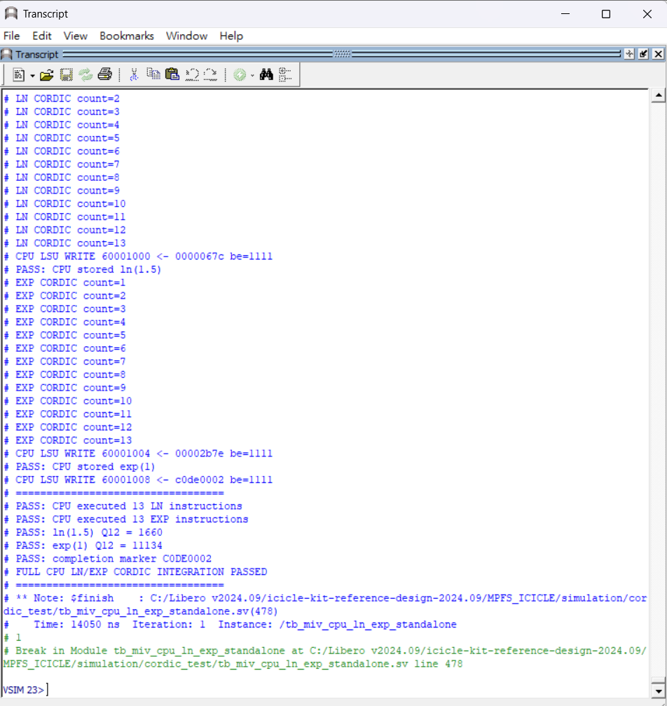
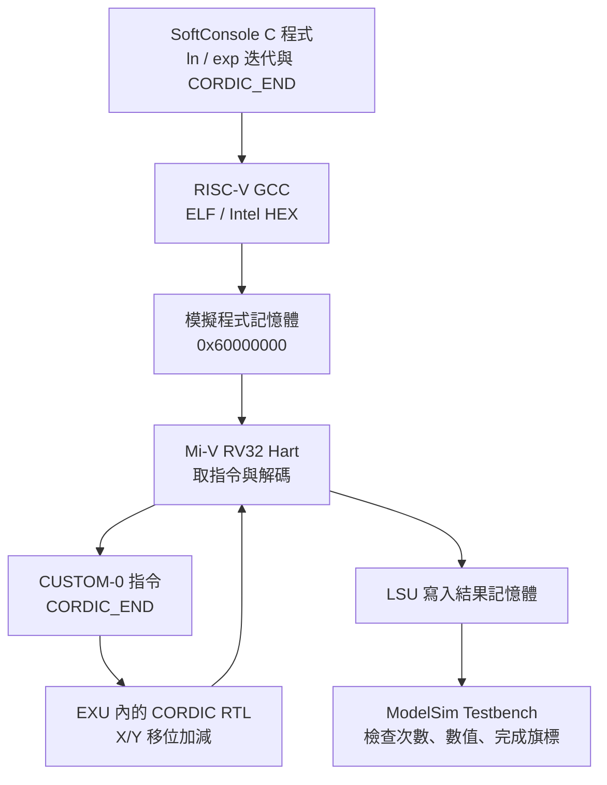
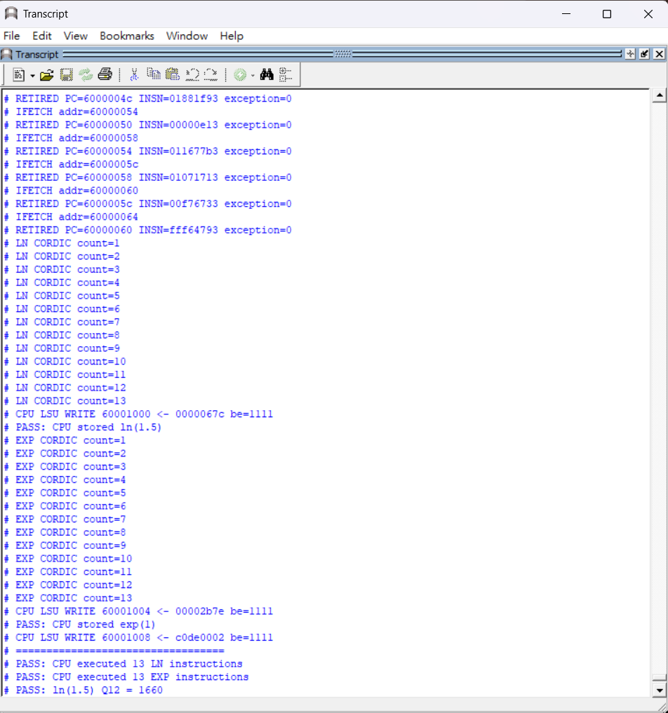

# Mi-V RV32 + CORDIC：ln／exp 自訂指令與 CPU RTL 整合驗證

> **2026-11 專題階段成果**｜Mi-V RV32 CPU × Hyperbolic CORDIC × SoftConsole × ModelSim
>
> **目前達成：** 完整 CPU 在 RTL 模擬中，使用自訂 `CORDIC_END` 指令計算 `ln(1.5)` 與 `exp(1)`，並成功將結果寫回記憶體。不是 FPGA 實機測試，尚未量測加速比。



## TL;DR｜到底做什麼？

學長提供**單通道 CORDIC 硬體**，每次透過移位與加減處理一個 `(X,Y)` 更新步驟。軟體負責安排雙曲線 CORDIC 的 **13 次迭代**、查表及 Q12 定點數的輸入輸出；Mi-V CPU 透過**自訂 RISC-V 指令**呼叫 CORDIC，而不是使用一般函式庫的 `log()` 或 `exp()`。

這份 Repository 以**完整 CPU RTL 驗證**為主要成果：SoftConsole 編譯的程式載入 ModelSim 的 RAM，`miv_rv32_hart` 取指令、解碼、執行 CORDIC，並透過 LSU 將答案寫回 RAM；Testbench 檢查每個關鍵條件。

### 系統流程



## 已驗證結果

| 項目 | CPU RTL 模擬結果 | 判定 |
|---|---:|---|
| ln(1.5) 的自訂指令執行 | 13 次 | PASS |
| exp(1) 的自訂指令執行 | 13 次 | PASS |
| ln(1.5) Q12 | `1660` / `0x0000067C` | PASS |
| exp(1) Q12 | `11134` / `0x00002B7E` | PASS |
| 完成旗標 | `0xC0DE0002` | PASS |
| CPU RTL 整合測試 | `FULL CPU LN/EXP CORDIC INTEGRATION PASSED` | **PASS** |

| 函數 | 理論值 | 模擬整數 / 4096 | 相對誤差 |
|---|---:|---:|---:|
| ln(1.5) | 0.405465108 | 0.405273438 | 約 0.0473% |
| exp(1) | 2.718281828 | 2.718261719 | 約 0.00074% |

數值採 **Q12** 固定小數點：4096 代表 1.0。本文測試的是兩個指定輸入，不代表所有 ln／exp 輸入範圍都經過驗證。

### 關鍵 Transcript 證據

```text
LN CORDIC count=13
CPU LSU WRITE 60001000 <- 0000067c  be=1111
EXP CORDIC count=13
CPU LSU WRITE 60001004 <- 00002b7e  be=1111
CPU LSU WRITE 60001008 <- c0de0002  be=1111
FULL CPU LN/EXP CORDIC INTEGRATION PASSED
```



## 核心設計：自訂指令

C 程式中的呼叫方式：

```c
#define CORDIC_END(rd, rs1, rs2) \
    __asm__ volatile ( \
      ".insn r 0x0B, 0x5, 0x03, %0, %1, %2\n\t" \
      : "=r"(rd) : "r"(rs1), "r"(rs2) : "memory")
```

- `opcode=0x0B`、`funct3=101`、`funct7=0000011`。
- `rs1={X[15:0],Y[15:0]}`；`rs2={dir, shift[6:0],24'b0}`。
- `rd={X'[15:0],Y'[15:0]}`：一次 CORDIC 迭代的新座標。
- 本次 compiled firmware 內自訂指令 word 是 `0x06F7578B`，分別出現在 `0x60000070`（ln）與 `0x600000F4`（exp），各由迴圈執行 13 次。

雙曲線 CORDIC 的 shift 順序為 `1,2,3,4,4,5,6,7,8,9,10,11,12`。ln 使用 vectoring（方向依據 Y）；exp 使用 rotation（方向依據 Z）。詳見 [`docs/HARDWARE_INTERFACE.md`](docs/HARDWARE_INTERFACE.md)。

## 目錄結構（GitHub 專題重點）

```text
MiV_RV32_CORDIC_GitHub/
├── README.md                           # 專題首頁、已驗證結果
├── firmware/
│   ├── cordic_ln_exp.c                 # CORDIC 自訂指令、13次 ln/exp 迴圈
│   ├── linker_example.ld              # 依專題設定整理的 linker 參考
│   └── reference_binary/
│       ├── mi-vuse-ln-exp.elf          # 提供的成功編譯版本
│       ├── mi-vuse-ln-exp.hex          # Intel HEX，和 ELF 同版本
│       ├── cpu_prog_ln_exp.mem         # ModelSim readmemh 參考映像
│       └── ...                         # 先前單步 CORDIC 成功版本
├── verification/
│   ├── tb_miv_cpu_ln_exp_standalone.sv # 已實際跑出 PASS 的 CPU TB
│   ├── tb_miv_cpu_cordic.sv            # 單條指令整合驗證 TB
│   ├── run_modelsim.do                 # ModelSim 操作腳本範本
│   └── optional/                       # 另讀外部 MEM 版本（需調整路徑）
├── scripts/
│   ├── intelhex_to_mem.py              # Intel HEX → $readmemh 格式
│   ├── verify_artifacts.py            # 驗證機器碼及靜態檔案一致性
│   └── math_reference.py              # 數學參考值／誤差重算
├── assets/screenshots/               # 實際 SoftConsole / ModelSim 證據
└── docs/
    ├── UNDERSTAND_THE_PROJECT.md      # 從零理解 CPU/EXU/Testbench 分工
    ├── PROFESSOR_PRESENTATION_SCRIPT.md # 4–5 分鐘逐字講稿與教授 Q&A
    ├── HARDWARE_INTERFACE.md          # 自訂指令與資料格式
    ├── GITHUB_UPLOAD.md               # GitHub 上傳教學
    └── MiV_CORDIC_RTL_Integration_Report.pdf
```

## 如何重跑完整 CPU 模擬

**需求：** Microchip SoftConsole 2022.2（韌體參考版本）、Libero SoC / ModelSim Microsemi Pro 2022.2、你們已修改的 `miv_rv32_pkg.v` 和 `miv_rv32_hart_merged.v`。**第三方 Mi-V RTL 不在此 Repository 中**，因此不提供即開即跑的 RTL 完整工程。

1. 在 Libero 專題開啟 ModelSim，使用之前已建立的 `presynth` library（如需要重新編譯，先包 `miv_rv32_pkg.v`，後 `miv_rv32_hart_merged.v`）。
2. 在 ModelSim 的 Transcript 執行：

   ```tcl
   quit -sim
   vlog -sv -work presynth "C:/<你的 GitHub 資料夾>/verification/tb_miv_cpu_ln_exp_standalone.sv"
   vsim -L presynth -L PolarFire presynth.tb_miv_cpu_ln_exp_standalone
   add wave -r /tb_miv_cpu_ln_exp_standalone/*
   run 100 us
   wave zoom full
   ```

   `quit -sim` 在尚未有模擬時可以略過。**這份 standalone TB 把當時驗證過的 firmware 嵌在 RAM 初始化區，不依賴外部 .mem 路徑。**
3. 看到 `FULL CPU LN/EXP CORDIC INTEGRATION PASSED` 代表 Testbench 規定的功能驗證通過。
4. 如需全部編譯順序參考，可編輯 [`verification/run_modelsim.do`](verification/run_modelsim.do) 內的 `hdl_dir`，再執行 `do "C:/.../verification/run_modelsim.do"`。

**重要：** ModelSim 若出現 `Recompile ... because miv_rv32_pkg has changed`，請依順序重新編譯 package → Hart RTL → testbench，再 `vsim`。不要直接使用 Libero 原有可能編譯其他 IP 測試檔的 `run.do`。

## 如何檢查 HEX、MEM 和 CORDIC 編碼

```bash
python scripts/verify_artifacts.py
python scripts/math_reference.py
python scripts/intelhex_to_mem.py firmware/reference_binary/mi-vuse-ln-exp.hex cpu_prog_ln_exp_new.mem
```

注意 **Intel HEX ≠ `$readmemh` 的文字格式**，不能直接把 `.hex` 當成一行一個 32-bit word 的 `.mem` 使用。這些 Python 檢查是**靜態檢查**；完整 CPU 行為仍須使用 ModelSim。

## 目前成果與限制

**已經驗證：** 自訂指令被完整 CPU 執行；ln/exp 各 13 次；LSU 寫入結果與完成標記；指定兩個測試點精度符合數學參考值。

**尚未驗證：** FPGA 板上執行、純軟體 vs 硬體的週期／加速比、最大操作頻率、面積功耗、廣泛輸入範圍與例外處理。**ModelSim 結束時間 14050 ns 不是 CPU 真實執行時間或加速比。**

## 報告與歸屬

- [教授報告講稿（逐字稿＋Q&A）](docs/PROFESSOR_PRESENTATION_SCRIPT.md)
- [我到底在做什麼？（白話技術說明）](docs/UNDERSTAND_THE_PROJECT.md)
- [正式專題報告 PDF](docs/MiV_CORDIC_RTL_Integration_Report.pdf)

**歸屬／公開注意事項：** 使用既有 Mi-V RV32 與學長留下的單通道 CORDIC 設計；本庫提供自行整理的示範軟體、測試平台、韌體映像及驗證結果。為避免未經授權散佈，未包含完整 Microchip/第三方 RTL；公開前請與團隊及指導教授確認權利。`LICENSE` 未預設，請在權利確認後補上適合的開源授權。
